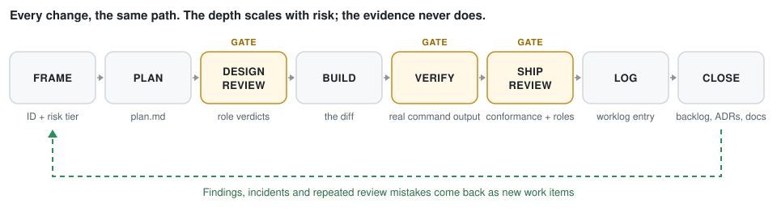

<p align="center">
  
</p>

**Nuhut** (chickpea) is a portable, stack-agnostic kit that makes an AI coding agent work
like a disciplined product team instead of a fast typist. It installs a short operating
contract (`AGENTS.md`), a set of process documents read on demand, and a standard-library
Python runtime that checks the records and runs the project's checks.

```sh
./install.sh /path/to/your-project        # guided setup; Enter takes every default
cd /path/to/your-project
python3 .ai-sdlc/bin/sdlc.py view --serve # watch the work, live, as agents do it
```

> **Status.** 4.0 has not been benchmarked. The 3.5.0 benchmark found that the kit
> changed agent behaviour in useful ways: tests always ran, bugs got a failing test
> first, work was traceable. It also cost about five times the tokens and time of no kit,
> with no measured gain in correctness on a strong model. Some of the benchmark's own
> checks were biased against the kit. 4.0 fixes the benchmark
> ([v2 changes](benchmarks/kit-value/README.md#v2-changes)) and cuts what the kit makes
> an agent read and write. The comparison of 4.0 against the 3.5.0 kit, tagged
> `bench-baseline-v0`, is pending; until it runs, no claim is made that 4.0 is cheaper or
> better in practice. The installer, runtime, hooks and benchmark code are tested
> (`validate.py`, `tests/smoke.py`, CI).

<p align="center">
  
</p>

## What an agent does with it

An agent that reads `AGENTS.md` classifies each change into one of three risk tiers by
**blast radius and reversibility**, not by topic, then runs the same loop at the depth
the tier needs:

| Tier | When | The agent |
| --- | --- | --- |
| 1 | it changes a contract others consume, stored data, auth, money-movement rules, a release pipeline, or is hard to reverse | plans, gets design and ship reviews (one from a different model family), writes an ADR, and stops for human approval |
| 2 | new or changed behaviour that tests cover and a revert undoes | writes a short plan, tests, a worklog entry, and commits as the charter says |
| 3 | a typo, a test, a patch bump | commits on the current branch; the commit message is the record |

Across tiers, it:

- **Frames** a request as a tracked item with an ID.
- **Verifies** with real commands. Only `sdlc.py verify` makes a result *Verified*.
- **Writes a failing test first** for a defect, and checks that the test catches it
  with `sdlc.py bite`.
- **Leaves the records true.**

A small arithmetic fix with a failing test first is Tier 2 even in a pricing module. A
one-line change to an authorisation check is Tier 1.

Each tier has a reading list with a word budget that CI enforces. `AGENTS.md` is 1,177
words, and a Tier 3 change reads about 1,500. Details:
[reading cost](docs/harnesses.md#reading-cost-and-small-models).

The charter also sets an **effort mode** (Lean, Normal, Beast), a **decision style**
(Ask, Guide, Autopilot) and a **development method** (Item, or Epic for several items
planned together). None of them lowers a tier's requirements. Its **Tier rules** row
picks `Standard`, the rules above, or `Strict`, which keeps the 3.x rules.

## Install

As a Claude Code plugin, for the `/sdlc-*` commands everywhere:

```
/plugin marketplace add rezar-84/nuhut.ai
/plugin install ai-sdlc@ai-sdlc
```

Into a project, for the contract, the documents, the charter and the per-project skills:

```sh
./install.sh                          # guided, arrow keys: shows what it detected first
./install.sh /path/to/project ACME --quick
./install.sh /path/to/project ACME -y --preset team --harness claude,codex,cursor
./install.sh --help                   # every option on one page; --explain tiers, --list <what>
```

The guided setup first shows what it found in the project and what it would set up. You
can take that as it is, customise some sections, or answer every question. Each question
has a hint and an example, and `?` explains it. Nothing is written until you confirm the
review screen. That screen can list every file the install would add, and it prints the
same install as a command line you can rerun with `-y`. `--plain` gives numbered, typed
prompts instead.

- **`--preset solo|team|regulated`** sets effort mode, decision style, development
  method and tier rules together. Any flag given as well wins.
- **`--harness`** points each agent tool at `AGENTS.md`. Naming any tool other than
  Claude Code also installs the skills, and the loop commands as skills, under
  `.agents/skills/`.
- **`--hooks`** installs tool-call guards for Claude Code, Gemini CLI and Cursor.
- **`--git-hooks`** installs commit guards that git runs for every tool and every human.
  Both kinds stay silent unless they refuse something.
- **The installer never overwrites a file.** Every option, the layout, managed
  platforms and stack detection are in [docs/install.md](docs/install.md).

## Which agent tools it works with

`AGENTS.md` is the contract, and most tools read it directly. The documents, the
runtime, the git hooks and CI work with any of them. Claude Code also gets typed
commands. Tools whose `/` menu lists skills get the same loop as skills: Antigravity,
Codex, Cursor, Gemini CLI and Copilot. The full table, per layer and per tool, is in
[docs/harnesses.md](docs/harnesses.md).

| Loop step | Claude Code | Other tools |
| --- | --- | --- |
| Plan, build, verify, review, log | `/sdlc-plan` … `/sdlc-log` | the `sdlc-plan` … `sdlc-log` skills |
| Audit the records | `/sdlc-doctor` | the `sdlc-doctor` skill |

## The runtime

`.ai-sdlc/bin/sdlc.py` does what needs no judgment, so a claim can cite a file the
script wrote instead of an agent's memory:

| Command | Does |
| --- | --- |
| `doctor` | audits the records. It flags stale backlog rows, a *Verified* claim with no evidence, and a Tier 1 item without an independent review. |
| `verify` | runs the charter's checks in order. It writes logs and adds a line per stage to a committed evidence ledger. |
| `bite <test command>` | confirms the tests fail without the change and pass with it |
| `log --since <ref>` | drafts worklog lines from commits and verify runs |
| `review <ID> --by codex` | gets one role's review from another harness and records who reviewed whom |
| `trailers <ID>` | prints the `Work-Item`, `Agent` and `Model` commit trailers |
| `plan-check <ID>` | compares the diff with the approved plan |
| `view` | opens a read-only page of the records. Add `--serve` for live updates or `--export-html` for a single file. |
| `metrics` | reports process measures, and agent budgets where recorded |

Everything is in [docs/runtime.md](docs/runtime.md).

## Upgrading from 3.x

```sh
./install.sh /path/to/project --upgrade
```

An upgrade replaces only unmodified kit files, keeps every project record and setting,
and backs up what it changes. A 3.x project gets **Tier rules: Strict**, which keeps the
3.x tiering, worklog and approval rules until you choose `Standard`. The retired static
`docs/dashboard.html` is removed only if unmodified. [CHANGELOG.md](CHANGELOG.md) has the
4.0 migration notes.

## More

- [docs/design.md](docs/design.md) explains what the kit deliberately does not do and
  how it relates to Spec Kit, Kiro and the app builders.
- [docs/skills.md](docs/skills.md) lists the model-invoked skills and when each is
  installed.
- [benchmarks/kit-value/](benchmarks/kit-value/README.md) is the protocol for measuring
  whether the kit is worth its cost.
- [CONTRIBUTING.md](CONTRIBUTING.md), [SECURITY.md](SECURITY.md) and [LICENSE](LICENSE)
  cover contributing, security reports and licensing.

The commands and paths still carry the kit's working name, `ai-sdlc`: `/sdlc-*`,
`.ai-sdlc/`, and the plugin ID. Renaming them would break `--upgrade` for existing
installs, so they change only in a release that migrates them.
