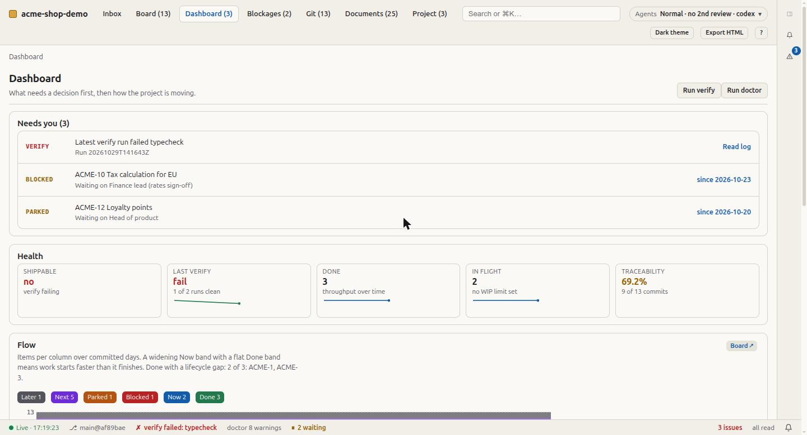
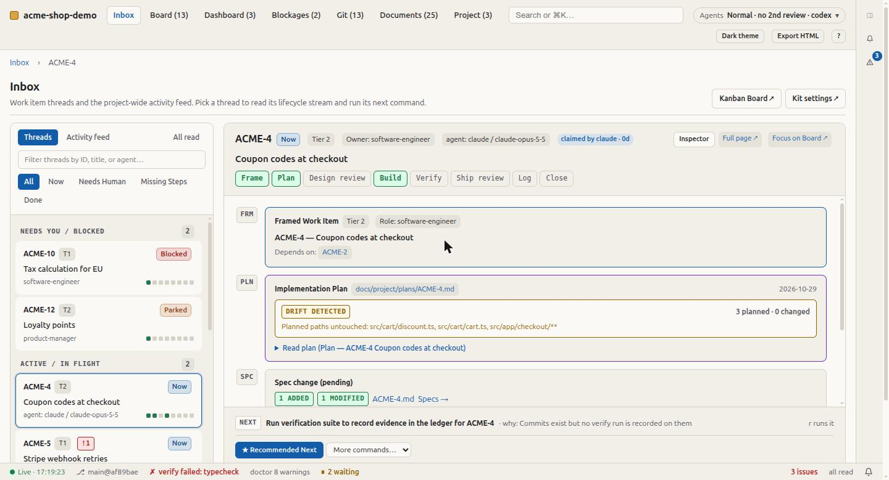
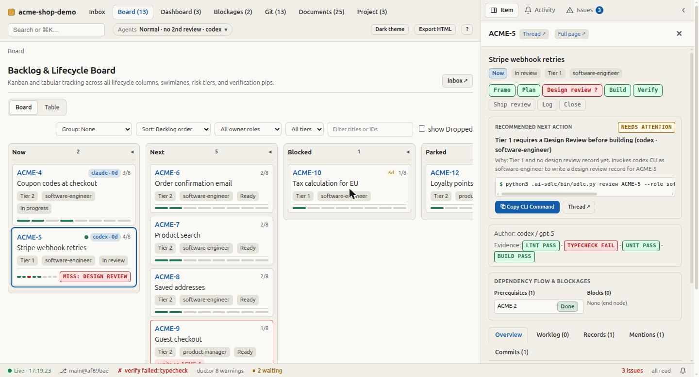
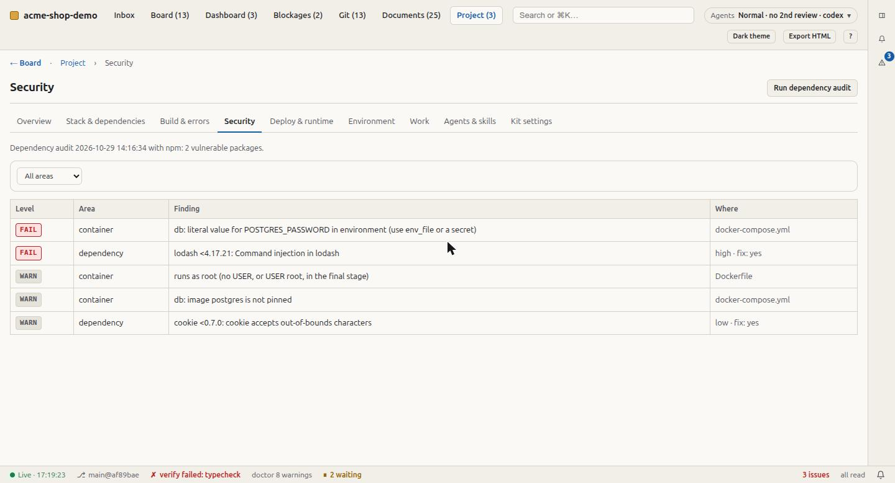
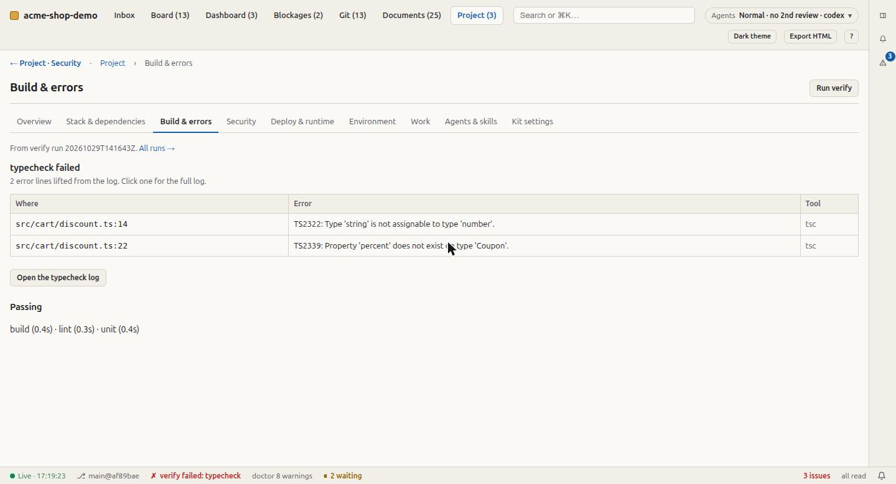

<p align="center">
  
</p>

<p align="center">
  <a href="https://github.com/rezar-84/nuhut.ai/actions/workflows/ci.yml"></a>
  <a href="https://github.com/rezar-84/nuhut.ai/releases"></a>
  <a href="LICENSE"></a>
  
  
</p>

**Nuhut** (chickpea) makes an AI coding agent work like a disciplined product team
instead of a fast typist. It installs a short operating contract (`AGENTS.md`), process
documents read on demand, and a standard-library Python runtime. The runtime checks the
records, runs the project's checks, and draws the whole project as one live page.

- **Risk-tiered process.** A typo is a commit; an auth change gets a plan, reviews from a
  second model family, an ADR and your approval. The tier is decided by blast radius and
  reversibility, not topic.
- **Proof, not claims.** Only a recorded `sdlc.py verify` run makes a result *Verified*.
  Every commit names its work item and agent. A doctor audits the records.
- **One place to see it all.** A live viewer shows what needs you, the work, build errors,
  vulnerable packages, deploy and environment, and the skills and MCP servers shaping your
  agents.

Stack-agnostic, works with any agent tool that reads `AGENTS.md`, and never overwrites a
file.

## Contents

[Quick start](#quick-start) · [Try it in one minute](#try-it-in-one-minute) ·
[What you get](#what-you-get) · [Commands](#commands) · [Works with](#works-with) ·
[Install options](#install-options) · [Upgrading](#upgrading) ·
[How it compares](#how-it-compares) · [FAQ](#faq) · [Documentation](#documentation) ·
[Status](#status)

## Quick start

Needs **Python 3.8+** and **git**. Nothing else.

```sh
git clone https://github.com/rezar-84/nuhut.ai.git
./nuhut.ai/install.sh /path/to/your-project     # guided: shows what it detected, asks the rest
cd /path/to/your-project
python3 .ai-sdlc/bin/sdlc.py view --serve       # the live viewer, beside your agent
```

Then ask your agent for a change. In Claude Code: `/sdlc-plan Add a "Remember me"
checkbox to login`. Other tools use the same loop as skills, or simply follow `AGENTS.md`.
The full walkthrough is in [getting started](docs/getting-started.md).

## Try it in one minute

See every view populated before installing into real work:

```sh
python3 nuhut.ai/tools/demo_project.py acme-shop-demo
cd acme-shop-demo && python3 .ai-sdlc/bin/sdlc.py view --serve
```

"Acme Shop" is fictional. It has a backlog in every column, dated commits from two
agents, real verify runs (the latest with a failing typecheck), a vulnerable dependency, a
Dockerfile, living specs and two claimed items.

<p align="center"></p>

## What you get

### A process scaled to risk

<p align="center">
  
</p>

| Tier | When | The agent |
| --- | --- | --- |
| 1 | it changes a contract others consume, stored data, auth, money-movement rules, a release pipeline, or is hard to reverse | plans, gets design and ship reviews (one from a different model family), writes an ADR, and stops for human approval |
| 2 | new or changed behaviour that tests cover and a revert undoes | writes a short plan, tests, a worklog entry, and commits as the charter says |
| 3 | a typo, a test, a patch bump | commits on the current branch; the commit message is the record |

Each tier has a reading list with a word budget that CI enforces. A Tier 3 change reads
about 1,500 words. The charter sets an **effort mode** (Lean, Normal, Beast), a **decision
style** (Ask, Guide, Autopilot) and a **method** (one item, or an epic of several). None of
them lowers a tier's requirements.

### Evidence and independent review

- `sdlc.py verify` runs the charter's checks and writes logs plus a committed evidence
  ledger. A *Verified* claim cites a file the script wrote, not an agent's memory.
- `sdlc.py bite` proves a test catches the defect: it fails without the change and passes
  with it.
- `sdlc.py review ACME-12 --role security --by codex` gets one role's review from another
  model family, and records who reviewed whom.
- `sdlc.py doctor` flags stale rows, unproven claims, Tier 1 items without an independent
  review, and leaked credentials.

### The viewer

<table>
<tr>
<td width="50%"><br><b>Inbox:</b> each item's story as a thread (plan, commits, verify runs, reviews), and its next command with the reason.</td>
<td width="50%"><br><b>Board:</b> lifecycle columns, ages, claims and verify results; any item opens beside the board.</td>
</tr>
<tr>
<td><br><b>Project:</b> stack and dependencies, build errors, vulnerable packages, secrets risks, deploy, CI and containers, env names, and the agentic stack.</td>
<td><br><b>Build &amp; errors:</b> <code>file:line</code> errors lifted from the failing verify log.</td>
</tr>
</table>

The Dashboard leads with **Needs you**: failing checks, security problems, and items
waiting on a person. It links to full pages for tests, runs and logs, and doctor
findings. A side panel holds the item you're looking at, notifications and issues. Every
view works from the keyboard. [The viewer, in full](docs/viewer.md).

### Several agents at once

```sh
python3 .ai-sdlc/bin/sdlc.py claim ACME-12   # atomic claim, its branch, its own worktree
python3 .ai-sdlc/bin/sdlc.py parallel        # which Ready items can run side by side
```

Claims are shared by every worktree, so a second agent is refused. `parallel` groups
Ready items whose plans touch different files, and treats migrations, lockfiles and the
charter as single-writer. [Multi-agent work](docs/multi-agent.md).

<p align="center"></p>

### Living specs (opt-in)

What the system does now, as requirements with WHEN/THEN scenarios in
`docs/project/specs/`. A work item that changes behaviour carries a spec change that is
merged when it closes. The headings match OpenSpec, so existing `openspec/` and Spec Kit
folders are read alongside without migrating. [Specs](docs/specs.md).

### Enforcement, when you want it

`--hooks` refuses unsafe tool calls in Claude Code, Gemini CLI and Cursor: a commit with no
work item, a credential in a file, an edit to a locked test, a gated deploy. `--git-hooks`
refuses the commit-time ones for every tool and every person. CI runs
`sdlc.py doctor --strict`.

## Commands

The runtime, `python3 .ai-sdlc/bin/sdlc.py <command>` (each has `-h` with examples):

| | |
| --- | --- |
| **Records and checks** | `doctor` audit the records · `verify` run the checks, keep the evidence · `bite` prove a test catches the change · `plan-check` diff vs plan |
| **Viewer and reports** | `view` the project as one page (`--serve` live) · `lens` stack, build, security, deploy, env, agents · `audit` vulnerable packages · `metrics` process measures |
| **Work items and agents** | `claim` / `release` / `claims` · `parallel` · `trailers` commit trailers · `review` independent review · `log` worklog lines from commits |
| **Specs** | `spec list \| show \| validate \| apply` |
| **Setup** | `config` see or change the charter's constraints · `fix` safe repairs |

In Claude Code: `/sdlc-plan`, `/sdlc-build`, `/sdlc-verify`, `/sdlc-review`, `/sdlc-log`,
`/sdlc-doctor`. Every flag: [command reference](docs/cli.md).

## Works with

`AGENTS.md` is the contract, and most tools read it directly. The documents, the runtime,
the git hooks and CI work with all of them.

| Loop step | Claude Code | Codex, Cursor, Gemini CLI, Copilot, Antigravity | Others (Windsurf, Cline, Roo, Amp, Aider, Jules, Zed, …) |
| --- | --- | --- | --- |
| Plan, build, verify, review, log | `/sdlc-plan` … `/sdlc-log` | the `sdlc-plan` … `sdlc-log` skills | `AGENTS.md` |
| Audit the records | `/sdlc-doctor` | the `sdlc-doctor` skill | `sdlc.py doctor` |

As a Claude Code plugin, for the `/sdlc-*` commands in every project:
`/plugin marketplace add rezar-84/nuhut.ai` then `/plugin install ai-sdlc@ai-sdlc`.
Details per tool: [agent tools](docs/harnesses.md).

## Install options

```sh
./install.sh                                    # guided, arrow keys; ? explains any question
./install.sh ~/code/shop SHOP --quick           # use what it detects, ask about 4 things
./install.sh ~/code/shop SHOP -y --preset team --harness claude,codex,cursor --hooks
./install.sh --help                             # one page; --help full, --list <what>, --explain <topic>
```

The guided setup first shows what it found (stack, check commands, AI tools) and what it
would set up. Nothing is written until you confirm the review screen, which can list
every file and prints the same install as a command you can rerun. `--plain` gives numbered
prompts for screen readers and logs. Everything is in [installing and upgrading](docs/install.md).

## Upgrading

```sh
./install.sh /path/to/project --upgrade
```

Upgrading replaces only the kit's own files that you have not changed. It keeps every
record and setting, adds new charter rows, and backs up what it changes. A 3.x project gets
**Tier rules: Strict**, which keeps the 3.x behaviour until you choose otherwise.
[CHANGELOG.md](CHANGELOG.md) has the migration notes. The kit itself is versioned
automatically from its commits, with semantic versioning.

## How it compares

Spec-driven tools (GitHub Spec Kit, OpenSpec, Kiro) answer *what should this feature do*.
Nuhut answers *how every change is made, reviewed, verified and recorded*: risk tiers, role
reviews, an evidence vocabulary, traceability, and a runtime that checks them. It also
carries opt-in living specs in OpenSpec's format, so you can use it alone or alongside
them. [What the kit is, and is not](docs/design.md).

## FAQ

**Will it overwrite my files?** No. Install never overwrites, and upgrade replaces only
unmodified kit files.

**Do I need Claude Code?** No. Any tool that reads `AGENTS.md` works; Claude Code adds
typed commands.

**Does it cost more tokens?** Some, scaled by tier. See [status](#status) for what has
been measured.

**Is the viewer safe to leave running?** It serves only on 127.0.0.1. It never reads
secret values (environment *names* only), and it keeps user-level items off exported
pages.

More: [troubleshooting and FAQ](docs/troubleshooting.md).

## Documentation

[Getting started](docs/getting-started.md) · [The viewer](docs/viewer.md) ·
[Multi-agent work](docs/multi-agent.md) · [Specs](docs/specs.md) ·
[Command reference](docs/cli.md) · [The runtime](docs/runtime.md) ·
[Installing](docs/install.md) · [Agent tools](docs/harnesses.md) ·
[Skills](docs/skills.md) · [Design](docs/design.md) ·
[Troubleshooting](docs/troubleshooting.md). Index: [docs/](docs/README.md).

## Status

The 3.5.0 benchmark found that the kit changed agent behaviour in useful ways: tests
always ran, bugs got a failing test first, and work was traceable. It also cost about five
times the tokens and time of no kit, with no measured gain in correctness on a strong
model. Some of the benchmark's own checks were biased against the kit.

4.x fixes the benchmark ([v2 changes](benchmarks/kit-value/README.md#v2-changes)) and cuts
what the kit makes an agent read and write. The comparison against the 3.5.0 kit (tag
`bench-baseline-v0`) has not run yet. Until it does, no claim is made that 4.x is cheaper
or better in practice.

The installer, runtime, viewer, hooks and benchmark code are tested (`validate.py`,
`tests/smoke.py`, CI).

## Contributing, security, licence

[CONTRIBUTING.md](CONTRIBUTING.md) · [SECURITY.md](SECURITY.md) · [LICENSE](LICENSE).

The commands and paths still carry the kit's working name, `ai-sdlc`: `/sdlc-*`,
`.ai-sdlc/`, and the plugin ID. Renaming them would break `--upgrade` for existing
installs, so they change only in a release that migrates them.
