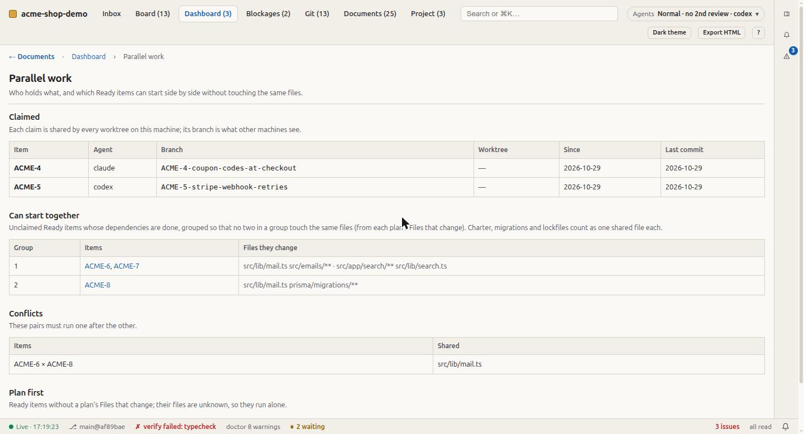

# Several agents at once

What changes when more than one agent works in a repository: parallel sessions, a team of
people each with an agent, or one orchestrator handing work to subagents. A single agent
working alone needs none of this.

The rules agents follow are in `docs/process/10-multi-agent.md` inside an installed
project. This page is the operator's view: what to run, and what the tooling guarantees.

## The failure this prevents

Two agents on one item is the characteristic failure. Both produce plausible work, both
write a worklog entry, and the second merge silently reverts the first. It looks like
progress until someone notices half a feature is gone.

## Claim, then work in your own worktree

```sh
python3 .ai-sdlc/bin/sdlc.py claim ACME-12            # claim + branch ACME-12-<slug> + ../<repo>-ACME-12
cd ../acme-shop-ACME-12                                # the item's own checkout
# … plan, build, verify, log …
python3 .ai-sdlc/bin/sdlc.py release ACME-12 --remove-worktree
```

- **The claim is atomic.** It is a file in the repository's shared git directory
  (`<git-common-dir>/nuhut/claims/ACME-12.json`), created with an exclusive create. A
  second agent asking for ACME-12 is refused, and told who holds it and since when.
- **Every worktree sees it.** All worktrees of a clone share the git directory, so
  parallel sessions on one machine see each other's claims. Across machines, add
  `--sync-refs` on `claim`, `release`, `claims`, `parallel` and `next-id` to publish
  compare-and-swap claim leases under `refs/nuhut/claims/<ID>` and atomic sequence
  allocations under `refs/nuhut/seq` on `origin`.
- **Each item gets its own worktree.** Parallel sessions in one checkout overwrite each
  other's files between commands, so `claim` creates a separate checkout by default
  (on `<type>/<ID>-<slug>`). `--no-worktree` makes the branch only.
- **Zero-conflict sharded records.** Each item writes its own state under
  `docs/project/items/<ID>.json`, its own worklog entry under `docs/project/worklog/<ID>.md`,
  and its own evidence lines under `docs/project/ledger/<run>.jsonl`. Parallel branches
  never touch the same line of `backlog.md`, `worklog.md`, or `evidence-ledger.jsonl`.
  Run `sdlc.py render` on the main branch when you want fresh Markdown summaries, and
  `sdlc.py fix migrate-shards --apply` to migrate an existing 4.x repository.
- **Two branches that edit the same item merge field by field.** The installer adds
  `docs/project/items/*.json merge=nuhut-shard` to `.gitattributes`. Run
  `python3 .ai-sdlc/bin/sdlc.py fix merge-driver` once in each clone; it prints the
  `git config` line and then sets it with absolute paths. From then on git hands item
  shards to `sdlc.py merge-shard`, which keeps both sides' changes to different fields,
  keeps every `history` entry, and takes the stricter tier. It writes conflict markers when
  both sides changed `approvers`, `waivers`, `status`, `hotfix` or `owner` differently, so a
  revoked approval or a status change is a person's decision. Other fields go to the newer
  `updated`, ignoring a stamp more than 5 minutes in the future. A file it cannot parse is
  left untouched and the merge stops.
- **Optional: keep the rendered views out of git.** `backlog.md` and `worklog.md` are views
  of the shards. A team that never reads them in a diff can add both to `.gitignore` and run
  `python3 .ai-sdlc/bin/sdlc.py render` in CI (or before publishing docs) instead. `doctor`
  reads the shards and does not fail when the two files are absent. Keep them committed if
  people read the backlog on the hosting site without running anything.
- **It refuses the obvious mistakes:** an item already claimed, one whose dependencies are
  unfinished, one that is Done or Dropped, or releasing a claim owned by another agent
  without `--force`. `release --remove-worktree` refuses a worktree with uncommitted changes.

`python3 .ai-sdlc/bin/sdlc.py claims` lists who holds what.

## What can run side by side

```sh
python3 .ai-sdlc/bin/sdlc.py parallel
```

```
group 1 (can run together): ACME-6, ACME-7
group 2 (can run together): ACME-8
conflict ACME-6 × ACME-8: src/lib/mail.ts
plan first (no Files that change): ACME-11
```

`parallel` takes the Ready items nobody holds whose dependencies are done. It groups them
so that no two in a group touch the same files, judging by each plan's **Files that
change** or, for Tier 2 and Tier 3 items without a full plan file, the item shard's
`touch` globs (`sdlc.py item add --touch "src/mail/*,tests/test_mail.py"`), with globs
compared both ways. The charter, migrations and lockfiles each count as one shared file:
two items with different migration files still conflict, because migrations are ordered.
Items with neither a plan nor `touch` globs are listed separately; their files are
unknown, so they run alone.

## Headless queue execution (`dispatch`)

When a queue of scoped Tier 2 and Tier 3 items is Ready, `dispatch` runs conflict-free
waves across isolated worktrees (`<git-common-dir>/nuhut/worktrees/<ID>`):

```sh
python3 .ai-sdlc/bin/sdlc.py dispatch --dry-run --workers 3
python3 .ai-sdlc/bin/sdlc.py dispatch --workers 3 --by claude --reviewer codex
python3 .ai-sdlc/bin/sdlc.py dispatch --workers 2 --by codex --pr --sync-refs
```

Each worker claims its item, runs the configured builder CLI (`claude`, `codex`, `gemini`,
or `cmd:<command>`), executes `verify --item <ID>` (plus `slop --strict` when configured)
with bounded repair retries (`--max-retries`), runs optional independent `review`, closes
sharded records through `finish`, and either merges Done Tier 2/3 branches back to the
default branch between waves or opens pull requests with `--pr`. Tier 1 items without an
approved plan file are skipped, and finished Tier 1 items stop at `Parked` for human
approval. Redacted run telemetry is written to `.ai-sdlc/dispatch/<run>.json` and shown in
the viewer.

## Controlled self-healing (`Discovered defects`)

When a worker or agent spots an out-of-scope bug (`Discovered: <description>` in `dispatch`,
or `sdlc.py item add --discovered`), the charter's **Discovered defects** row decides
whether it enters the queue automatically:

- **`Parked`** (the default): every newly discovered defect waits in `Parked` for human
  triage.
- **`Auto-Ready (bite)`**: a Tier 2 or Tier 3 defect promotes to `Ready` via
  `sdlc.py item triage <ID>` only after `sdlc.py bite --item <ID> <test cmd>` records a
  reproducing test that failed before the fix and passed with it. Tier 1 defects stay
  `Parked`.

The Dashboard shows the same thing under **Parallel work**, and Board cards carry a claim
badge.

<p align="center"></p>

The limit on parallel sessions is how many a person can review properly, not how many a
machine can run. Add a session only while reviews keep up.

## Reviews fan out; builds do not

Role reviews are the natural thing to run in parallel. A reviewer needs one playbook and
the diff, a few thousand tokens, not the whole operating context. Six roles reviewed at
once cost six small contexts.

```sh
python3 .ai-sdlc/bin/sdlc.py review ACME-12 --role security  --by codex
python3 .ai-sdlc/bin/sdlc.py review ACME-12 --role architect --by gemini
```

Each review is saved with the reviewer's and the author's identity and labelled
independent (a different model family) or self-check. A reviewer rates, and the
orchestrator maps severity to a verdict. A reviewer never waives its own blocker, and a
human clears a Block.

Do not fan out the build of one item. Two agents editing the same change produce a merge
nobody reviewed.

## Evidence across agents

A claim is *Verified* only for the agent that ran the command and read the output.
Everything relayed from a subagent, or read from another agent's worklog entry, is
*Reported*, with its source named. An orchestrator that needs *Verified* runs
`sdlc.py verify` itself. The evidence ledger (`docs/project/evidence-ledger.jsonl`)
records which commit each run was on, so anyone can check.

## What doctor watches

- A claim older than the charter's staleness window with no commit on its branch since:
  re-claim it deliberately, or release it.
- A claim on an item that is already Done or Dropped: a forgotten release.
- Two branches for one claimed item: two agents may be on it.

## Without the runtime

For an agent tool that cannot run shell commands, the fallback is manual. Set the backlog
row's Owner to the agent's identity and its status to In progress, commit that edit on its
own, and pick another item if the row is already owned.
