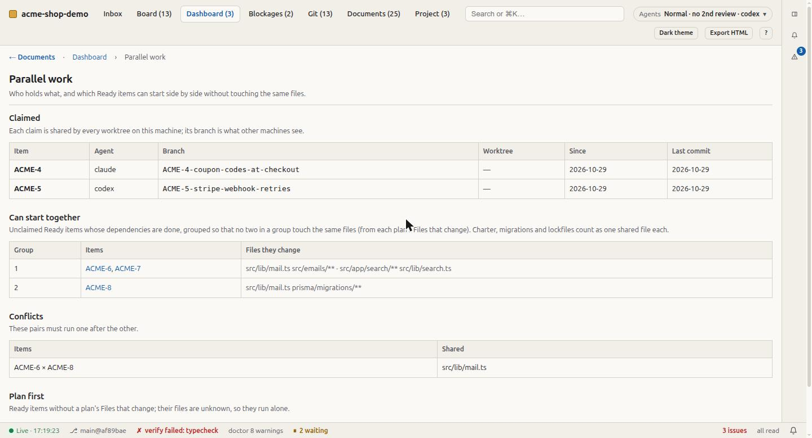

# Several agents at once

What changes when more than one agent works in a repository: parallel sessions, a team of
people each with an agent, or one orchestrator handing work to subagents. A single agent
working alone needs none of this.

The rules agents follow are in `docs/process/10-multi-agent.md` inside an installed
project. This page is the operator's view: what to run, and what the tooling guarantees.

## The failure this prevents

Two agents on one item is the characteristic failure. Both produce plausible work, both
write a worklog entry, and the second merge silently reverts the first. It looks like
progress until someone notices half a feature is gone.

## Claim, then work in your own worktree

```sh
python3 .ai-sdlc/bin/sdlc.py claim ACME-12            # claim + branch ACME-12-<slug> + ../<repo>-ACME-12
cd ../acme-shop-ACME-12                                # the item's own checkout
# … plan, build, verify, log …
python3 .ai-sdlc/bin/sdlc.py release ACME-12 --remove-worktree
```

- **The claim is atomic.** It is a file in the repository's shared git directory
  (`<git-common-dir>/nuhut/claims/ACME-12.json`), created with an exclusive create. A
  second agent asking for ACME-12 is refused, and told who holds it and since when.
- **Every worktree sees it.** All worktrees of a clone share the git directory, so
  parallel sessions on one machine see each other's claims. Across machines, the
  claim's branch (`ACME-12-<slug>`, pushed) is what others see.
- **Each item gets its own worktree.** Parallel sessions in one checkout overwrite each
  other's files between commands, so `claim` creates a separate checkout by default.
  `--no-worktree` makes the branch only.
- **The backlog row is optional.** `claim --mark` sets the row to In progress, but only
  from the main worktree. Every worktree has its own copy of `backlog.md`, and marking rows
  in several of them produces conflicting backlog edits at merge time.
- **It refuses the obvious mistakes:** an item already claimed, one whose dependencies are
  unfinished, one that is Done or Dropped. `release --remove-worktree` refuses a worktree
  with uncommitted changes.

`python3 .ai-sdlc/bin/sdlc.py claims` lists who holds what.

## What can run side by side

```sh
python3 .ai-sdlc/bin/sdlc.py parallel
```

```
group 1 (can run together): ACME-6, ACME-7
group 2 (can run together): ACME-8
conflict ACME-6 × ACME-8: src/lib/mail.ts
plan first (no Files that change): ACME-11
```

`parallel` takes the Ready items nobody holds whose dependencies are done. It groups them
so that no two in a group touch the same files, judging by each plan's **Files that
change**, with globs compared both ways. The charter, migrations and lockfiles each count
as one shared file: two items with different migration files still conflict, because
migrations are ordered. Items with no plan are listed separately; their files are
unknown, so they run alone.

The Dashboard shows the same thing under **Parallel work**, and Board cards carry a claim
badge.

<p align="center"></p>

The limit on parallel sessions is how many a person can review properly, not how many a
machine can run. Add a session only while reviews keep up.

## Reviews fan out; builds do not

Role reviews are the natural thing to run in parallel. A reviewer needs one playbook and
the diff, a few thousand tokens, not the whole operating context. Six roles reviewed at
once cost six small contexts.

```sh
python3 .ai-sdlc/bin/sdlc.py review ACME-12 --role security  --by codex
python3 .ai-sdlc/bin/sdlc.py review ACME-12 --role architect --by gemini
```

Each review is saved with the reviewer's and the author's identity and labelled
independent (a different model family) or self-check. A reviewer rates, and the
orchestrator maps severity to a verdict. A reviewer never waives its own blocker, and a
human clears a Block.

Do not fan out the build of one item. Two agents editing the same change produce a merge
nobody reviewed.

## Evidence across agents

A claim is *Verified* only for the agent that ran the command and read the output.
Everything relayed from a subagent, or read from another agent's worklog entry, is
*Reported*, with its source named. An orchestrator that needs *Verified* runs
`sdlc.py verify` itself. The evidence ledger (`docs/project/evidence-ledger.jsonl`)
records which commit each run was on, so anyone can check.

## What doctor watches

- A claim older than the charter's staleness window with no commit on its branch since:
  re-claim it deliberately, or release it.
- A claim on an item that is already Done or Dropped: a forgotten release.
- Two branches for one claimed item: two agents may be on it.

## Without the runtime

For an agent tool that cannot run shell commands, the fallback is manual. Set the backlog
row's Owner to the agent's identity and its status to In progress, commit that edit on its
own, and pick another item if the row is already owned.
