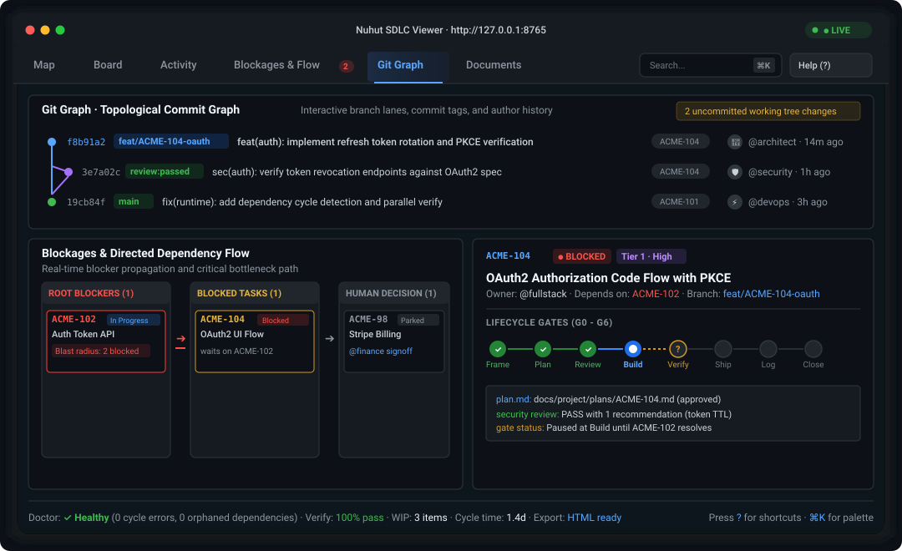

# The runtime: sdlc.py

The mechanical half of the process, and the viewer.

## Scripts for what does not need judgment

A rule written as prose is a request the agent may or may not honour. The same rule as a
check either passes or fails. So the parts of the process a machine can decide are a
script, not a paragraph. Every install gets
`.ai-sdlc/bin/sdlc.py`: standard-library Python, kit-managed, and refreshed by `--upgrade`.

<p align="center">
  
</p>

```sh
python3 .ai-sdlc/bin/sdlc.py doctor            # audit commands, staleness, profile drift, and
                                               # dependency loops/missing IDs
python3 .ai-sdlc/bin/sdlc.py doctor --strict   # exit 1 on any fail-level finding, for CI
python3 .ai-sdlc/bin/sdlc.py verify            # run charter checks in order and record evidence
python3 .ai-sdlc/bin/sdlc.py verify --parallel # run independent checks concurrently (-j)
python3 .ai-sdlc/bin/sdlc.py plan-check ACME-12 # check git diff against approved plan/spec
python3 .ai-sdlc/bin/sdlc.py view              # draw records as an interactive HTML dashboard
python3 .ai-sdlc/bin/sdlc.py view --serve      # the same page, live: follows records & git history
python3 .ai-sdlc/bin/sdlc.py view --export-html out.html # export self-contained report for CI/CD
python3 .ai-sdlc/bin/sdlc.py metrics           # process measures, leading and lagging
python3 .ai-sdlc/bin/sdlc.py log --since main   # draft worklog lines from commits and verify runs
python3 .ai-sdlc/bin/sdlc.py bite <test command> # do the tests fail without the change?
python3 .ai-sdlc/bin/sdlc.py trailers ACME-12   # print the Work-Item / Agent / Model trailers
python3 .ai-sdlc/bin/sdlc.py review ACME-12 --role security --by codex  # independent review
python3 .ai-sdlc/bin/sdlc.py config --token-saving on  # toggle Lean + single-agent review + compact budget
python3 .ai-sdlc/bin/sdlc.py fix all            # sync profile, repair harness pointers, unlock stale guards
```

| Command | Key Flags | Description |
| --- | --- | --- |
| **`doctor`** | `--strict` | Audits project records, active roles, check commands, staleness windows, and validates the dependency graph (flags self-dependencies, non-existent backlog IDs, and circular dependency loops). Ages the backlog against the same window: an `In progress` or `In review` row nothing has named since the window passed is a zombie claim; a `Ready`, `Blocked` or `Parked` row older than the window needs a decision. |
| **`verify`** | `--parallel` (`-j`), `--stage`, `--timeout` | Runs the charter's check pipeline in order, writing immutable test evidence (`summary.md`, `summary.json`, and stage `.log` files) to `.ai-sdlc/evidence/<timestamp>/`. `--parallel` runs independent steps concurrently using a worker pool. |
| **`plan-check <ID>`** | | Compares branch changes against the approved plan (`docs/project/plans/<ID>.md` or `.sdlc/specs/<ID>/spec.md`). Highlights unapproved file modifications and planned files left untouched with ANSI terminal colors. |
| **`view`** | `--serve`, `--port`, `--interval`, `--export-html <file>`, `--svg`, `--no-open` | Generates the rich interactive developer dashboard. Opens with per-item **Action Threads** (chat-like chronological timelines), a project Mind Map, Kanban Board with cumulative-flow chart, Activity, Blockages & Flow, Git Graph, Documents, and a **Kit & Control** panel. `--serve` runs a reactive local server on `127.0.0.1` with live constraint and repair controls. `--export-html` bundles an offline read-only single-file report for CI/CD artifacts or PR previews. |
| **`metrics`** | `--json` | Calculates quantitative project health metrics: work-in-progress (WIP), verification pass rate, cycle time, lead time, time waiting on humans, lifecycle record gaps, and usage against the charter's optional agent budget per tier. |
| **`log`** | `--since <ref>`, `--write` | Drafts worklog lines, one per work item, from the commits since `<ref>` (IDs from subjects or `Work-Item` trailers) and the verify runs recorded on them. `--write` inserts them under the worklog's marker, newest first, skipping items the worklog already names. Records become byproducts, not essays. |
| **`bite`** | `--base`, `--timeout`, `--restore`, `--json` | Puts the changed product files (never tests, never the kit's paths) back to the base, runs the test command, and restores them. It passes only when the tests pass with the change and fail without it. A backup and marker under `.ai-sdlc/bite/` make an interrupted run recoverable with `--restore`, and the doctor flags one. |
| **`trailers <ID>`** | `--agent`, `--model` | Prints the `Work-Item`, `Agent` and `Model` commit trailers, from flags, `AI_SDLC_AGENT` / `AI_SDLC_MODEL`, or what the harness exposes. |
| **`review <ID>`** | `--role`, `--by claude\|codex\|gemini\|cmd:<command>`, `--model`, `--stage` | Sends one role's playbook, the item's diff, the relevant charter rows and the tier to another harness, headless, and saves the review with the reviewer's and author's identity, labelled independent or self-check. |
| **`config`** | `--effort`, `--independent-review`, `--tier-rules`, `--decision-style`, `--dev-method`, `--reviewer`, `--token-saving`, `--set-check`, `--json` | Inspects or atomically updates kit constraints in `docs/project/charter.md` and syncs `.ai-sdlc/profile.json`. `--token-saving on` switches to `Lean` effort, `Independent review required for: none`, `Standard` tier rules, and compact tier budgets in one step. |
| **`fix`** | `<sync-profile\|wire-pointer\|restore-bite\|unlock-tests\|all>`, `--harness`, `--json` | Repairs safe, non-destructive setup drift: syncs `.ai-sdlc/profile.json` from the charter, restores missing `AGENTS.md` pointer lines (`CLAUDE.md`, `.cursor/rules/`, etc.), restores interrupted `bite` backups, and clears stale test locks. Never modifies SHA-256-tracked kit files in `.ai-sdlc/manifest.json`. |

**Evidence.** `verify` and `bite` also append one line per stage to
`docs/project/evidence-ledger.jsonl`: commit, whether the tree was dirty, stage, command,
exit code, output hash and time. The logs stay in the git-ignored evidence folder; the
ledger is committed, so a reviewer or CI can check a claim against it. The doctor flags a
worklog entry that says *Verified* when the ledger has no run for that item's change, and
fails a built Tier 1 item without a review from a model family other than the author's.

`verify` exists so a "Verified" claim can cite a file the script wrote instead of the
agent's memory of a run. `/sdlc-doctor` and `/sdlc-verify` call the script first and keep
the judgment for themselves: severity, behavioural checks, and what to fix first. It works
with any agent tool that can run `python3`. `/sdlc-review` opens every Tier 1 ship review
with `plan-check`, so a diff that drifted from its approved plan is visible before any role
reads it.

### Seeing the work

Records written for an agent are hard for a person to read once a project is real: a
worklog runs to thousands of lines, and one item's story is spread over a backlog row, a
plan, two reviews and a worklog entry. `sdlc.py view` reads them all at the moment you run
it and opens one comprehensive, navigable page joined by work item ID:

<p align="center">
  
</p>

The viewer organizes project reality across seven views, with an inspector beside them
and an activity bar along the bottom:

- **Inbox:** two modes over the same work items.
  - **Items** groups work items into *Needs you* (Blocked/Parked), Active, Ready and Completed. Unread items get a dot.
  - **Activity feed** lists every item's events newest day first: commits, verify runs, reviews, gates, worklog entries and records. Each item gets one row per day ("5 commits · 1 verify run"). Kind filter chips and an *Unread only* switch narrow it.
  - Picking a thread shows its lifecycle stream (`Frame` ➔ `Plan` ➔ `Design Review` ➔ `Build` commits with `Agent`/`Model`/`Tokens` trailers ➔ `Verify` ➔ `Ship Review` ➔ `Worklog`) and the Command Dock.
  - Read state stays in this browser only. The first visit marks everything read.
- **Board:** Kanban columns (Now, Next, Blocked, Parked, Later, Done), filtered by owner, tier or text.
  - Cards show dependency blockers, an unread dot, the last verify result and an age badge (days in column from the `Since` cell; amber at 3, red at 7).
  - A `wip_limit` in the charter constraints shows the Now count as `n/limit`.
- **Dashboard:** what needs a decision first, then how the project is moving.
  - **Needs you:** failing doctor findings, a failed verify run and every blocked or parked item, each opening its detail (j/k walk the list).
  - **Health:** shippable or not, last verify, Done, in flight, git traceability, each saying what it covers.
  - **Flow** chart, then summaries of Tests & verify, Runs & logs, Doctor and project stats, each with *View all* leading to its own page:
  - **Tests & verify** (`#/dashboard/tests`): every run × stage at full width (click a cell for its log), and a stage table with last result, duration trend, pass rate and a flaky flag. Stages the project never runs are hidden behind a toggle.
  - **Runs & logs** (`#/dashboard/runs`): runs filtered by kind, result and text on the left, the selected run's log on the right; the selection is in the URL.
  - **Doctor** (`#/dashboard/doctor`): findings grouped by rule, failures first, filterable by level and text; each finding opens with its full advice.
- **Blockages & Flow:** a dedicated dependency and blockage command center:
  - **Directed Flow Board:** 3-column triage (`Root Blockers` ➔ `Blocked Tasks` ➔ `Waiting on Human`).
  - **Bottleneck Matrix:** items ranked by blast radius (number of downstream tasks blocked).
  - **Human Decision Log:** items parked awaiting human sign-off with stall durations.
  - **Dependency Table:** explicit relationships and quick navigation.
- **Git Graph:** visual topological Git commit graph positioned prominently above the fold:
  - Multi-branch commit lanes with branch splits, merges, and commit dots.
  - Commit badges (`main`, `review:passed`), author avatars, and relative timestamps.
  - Interactive commit drawer showing full commit message, SHA, author, and changed files.
  - Uncommitted working tree summary banner and local branches overview.
- **Documents:** every project artifact with frontmatter status (`draft`, `approved`, `stale`),
  accountable owner, and age. Click to open with interactive outlines and cross-linked IDs.
- **Kit & Control:** an interactive control panel for adjusting kit constraints (`Default effort mode`, `Independent review required for`, `Tier rules`, `Decision style`, `Development method`, `Default reviewer`), toggling **Token-Saving Mode** (`Lean` + single-agent review + compact budgets), inspecting installed harnesses/hooks/CLI tools and per-tier reading budgets, and running 1-click safe repairs (`sync-profile`, `wire-pointer`, `restore-bite`, `unlock-tests`).

**Side panel.** On screens 1100px and wider a panel sits beside the page with three tabs:
- **Item:** the card, run, commit, document or finding you clicked, while the list stays usable (j/k move the selection and the panel follows). Links inside it stack, with a back arrow.
- **Activity:** what changed while the page was open (new commits, reviews and verify runs, items moving, doctor changes). The bell and `n` open it.
- **Issues:** everything that would otherwise be a warning above some page: doctor failures, kit repairs and setup warnings, statuses the board has no column for, records the view could not read, unsaved static edits.

Closing it (`]`, `Esc` or the fold button) folds it to a rail of those three tabs instead of removing it; drag its left edge to resize it. Narrower screens use a slide-over.

**Activity bar.** The bar at the bottom shows live state, branch, the latest verify result, doctor status, waiting items, the running or last command, the issue count and unread items; each links to where it comes from. Only verify failures, doctor regressions, items becoming blocked and finished commands raise a toast.

**Going back.** Pages opened from a list (an item's full page, a document, a Dashboard page, the map, a search) show a Back link to that list, e.g. *← Inbox · DS-042*; `Backspace` and `Alt+←` do the same.

**Statuses.** The board maps common status words to the kit's columns (Planned or Pending → Next, Completed or "Done on …" → Done, On hold → Parked, Cancelled → Dropped); the item keeps the text it was written with.

#### Item Lifecycle Stepper

Click any work item ID anywhere to open its deep inspector. The lifecycle stepper runs
from Frame to Close (`Frame` ➔ `Plan` ➔ `Design Review` ➔ `Build` ➔ `Verify` ➔ `Ship Review` ➔ `Log` ➔ `Close`).
Green means the record for that step exists. An amber **?** means the item's tier and
status call for a record that does not exist yet (such as a Tier 1 item in progress with
no plan, or a Done item with no worklog entry). That is a real gap to close, not a display
fault.

#### Keyboard Shortcuts & Navigation

| Shortcut | Action |
| --- | --- |
| **`⌘K`** or **`Ctrl+K`** | Open Command Palette to search all work items, documents, and headings. |
| **`?`** | Toggle the Keyboard Shortcuts & Help modal. |
| **`1` - `7`** | Switch views: `1` Inbox, `2` Board, `3` Dashboard, `4` Blockages, `5` Git Graph, `6` Documents, `7` Kit & Control. Old `#/activity` and `#/cockpit` links still resolve; `#/map` opens the map. |
| **`j` / `k`**, **`h` / `l`** | Move through the Inbox or Board cards (arrows work too); the inspector follows. `o` opens the item's page. |
| **`]`** | Show or hide the inspector. |
| **`n`** | Notifications. |
| **`t`** | Toggle Dark / Light theme. |
| **`]`** / **`n`** | Open or fold the side panel / open its Activity tab. |
| **`Backspace`** | Back to the list you came from. |
| **`/`** | Open the Command Palette search input. |
| **`Esc`** | Close open modal, commit drawer, or clear active search filter. |

**A daily routine that works:** open the **Dashboard**'s *Needs you*, then the **Inbox** feed with *Unread only* to see what changed, then **Blockages & Flow** to clear what waits on you. Before calling an item done, open its thread or inspector and check that no step is amber.

With `--serve` the page is live: leave it open while agents work, and it redraws
within a couple of seconds of any record changing or a new commit, keeping your place, folds
and filters. It serves only on 127.0.0.1 and refuses requests addressed to any other host.
In `--serve` mode, the **Kit & Control** tab can apply charter constraint changes and safe kit
repairs directly via session-token-protected (`X-Action-Token`) local endpoints (`/api/config`
and `/api/fix`); in static HTML exports (`--export-html`), those controls automatically copy
the equivalent `sdlc.py config` or `sdlc.py fix` CLI command to your clipboard. Commands run
from the page (`/api/run`) are kept, redacted, under the git-ignored `.ai-sdlc/runs/` (newest 50)
and listed under Dashboard → Runs & logs. Their output and each verify stage's log are read on demand through
`GET /api/log?kind=evidence|run&id=…[&stage=…]`, which serves only a known stage log or kept run. Ctrl+C stops
the server; `--port` and `--interval` tune it. Rows the view cannot read are listed on the
page rather than dropped.

With `--export-html <path>`, `sdlc.py view` generates a standalone, self-contained single-file
HTML bundle embedding the entire data model. It runs offline without a local server, making
it ideal for CI/CD artifact publishing, PR status reports, and static team dashboards.

The opt-in `--hooks` go one step further for Claude Code. They deny the tool call itself:

- a commit with no work item ID, or with a credential in it
- a file write containing a credential, with a warning when personal data is written to a record
- an edit to a single-writer path
- an edit to a reproducing test locked while its defect is fixed
- a command, such as a production deploy, that `.ai-sdlc/gates.txt` says a human must pass

A skill makes a violation rare, and a hook makes it close to impossible. See
`optional/hooks/README.md` for what each hook can and cannot see. With `--harness gemini`
the same six rules are registered in `.gemini/settings.json`, and with `--harness cursor`
the three shell rules in `.cursor/hooks.json`; `adapter.sh` translates the payload and
the verdict, so each rule still lives in one script.

The opt-in `--git-hooks` cover the two commit-time rules for **every** agent and every
human, because git runs them, not the harness: a `pre-commit` that refuses staged
credentials and a `commit-msg` that refuses a message with no work item ID
(`--git-hooks secrets` installs only the first). The scripts live in
`.ai-sdlc/git-hooks/`; the project's existing hook, husky file or `core.hooksPath`
directory gets one line appended and is otherwise left alone, and with pre-commit.com
or lefthook the entry to add is printed instead. `git commit --no-verify` bypasses them,
deliberately and visibly. The enforcement nobody can skip is CI: `--scaffold-ci` puts
`sdlc.py doctor --strict` before the quality commands.
