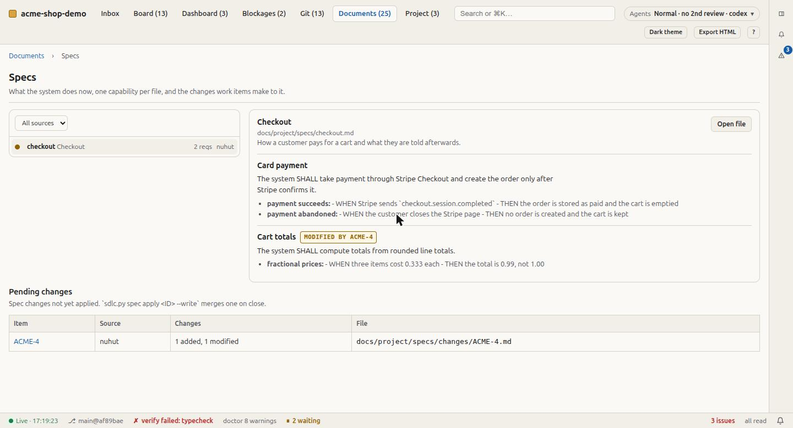

# Living specs

A spec says what the system does **now**, as requirements with scenarios. A plan says
what one work item will change. After a hundred items, nobody can reconstruct current
behaviour from a hundred plans, but anyone can read one spec.

Specs are **opt-in**: off by default, so projects that do not want them pay nothing.

## Turn them on

```sh
./install.sh /path/to/project ACME --specs on                 # at install
python3 .ai-sdlc/bin/sdlc.py config --specs on                # later
```

The guided setup also asks *Keep living specs of what the system does?* in the Process
section. Turning specs on sets the charter's **Specs** row to `on`, creates
`docs/project/specs/changes/`, and (at install) adds the `sdlc-spec` skill.

## The format

One file per capability, `docs/project/specs/<capability>.md` (template:
`docs/templates/spec.md`):

```markdown
# Checkout

## Purpose

How a customer pays for a cart and what they are told afterwards.

## Requirements

### Requirement: Card payment
The system SHALL take payment through Stripe Checkout and create the order only after
Stripe confirms it.

#### Scenario: payment succeeds
- **WHEN** Stripe sends `checkout.session.completed`
- **THEN** the order is stored as paid and the cart is emptied
```

Every requirement says SHALL or MUST and has at least one scenario with both WHEN and
THEN. The headings are the ones OpenSpec uses, on purpose.

## A work item's change

A Tier 1 or 2 item that changes behaviour someone outside the code can observe carries
`docs/project/specs/changes/<ID>.md` (template: `docs/templates/spec-change.md`):

```markdown
Capability: `checkout`

## ADDED Requirements
### Requirement: Coupon codes
…

## MODIFIED Requirements
### Requirement: Cart totals
(the whole requirement as it will read, with all its scenarios)

## REMOVED Requirements
### Requirement: Lockout
(why it goes)
```

- `/sdlc-plan` drafts it with the plan and links it from the plan's **Spec changes** line.
- Every scenario becomes a test or an acceptance check.
- Refactors, Tier 3 changes, and anything no user or caller can observe need no change:
  the plan says `none` and why.

## Commands

```sh
python3 .ai-sdlc/bin/sdlc.py spec list                 # capabilities, imported specs, pending changes
python3 .ai-sdlc/bin/sdlc.py spec show checkout
python3 .ai-sdlc/bin/sdlc.py spec validate --strict    # SHALL/MUST, scenarios, WHEN+THEN, names exist
python3 .ai-sdlc/bin/sdlc.py spec apply ACME-4         # dry run: what the merge would do
python3 .ai-sdlc/bin/sdlc.py spec apply ACME-4 --write # merge on close, archive the change
```

`apply` matches MODIFIED and REMOVED by **exact requirement name**. It refuses when a name
is missing or appears twice, rather than guessing. Fix the change file, never force it.
The applied change moves to `specs/changes/archive/<date>-<ID>.md`. `/sdlc-log` runs
`apply --write` when it closes the item.

With specs on, `doctor` warns about:
- a requirement with no scenario
- a change naming a requirement that does not exist
- a Done item whose change was never applied

With specs off, it says nothing about specs.

## Specs written by other tools

- **OpenSpec:** `openspec/specs/**/spec.md` and the deltas under `openspec/changes/` are
  read with the same parser.
- **Spec Kit:** `specs/<feature>/spec.md` beside `.specify/` is read best-effort:
  `FR-###` requirements and Given/When/Then acceptance scenarios. Its templates are free
  form.

Both appear in the viewer (Documents ▸ Specs) labelled by source. They are never rewritten
and never fail a check. A team already using either keeps its folders; nothing has to
migrate.

<p align="center"></p>

## Brownfield: specs for code that already exists

The `sdlc-spec` skill writes a capability spec from the code and tests for one
capability. It describes only behaviour it can point to, cites the file next to each
scenario, and marks anything inferred but unconfirmed as **Unknown** rather than writing
it as a requirement.
